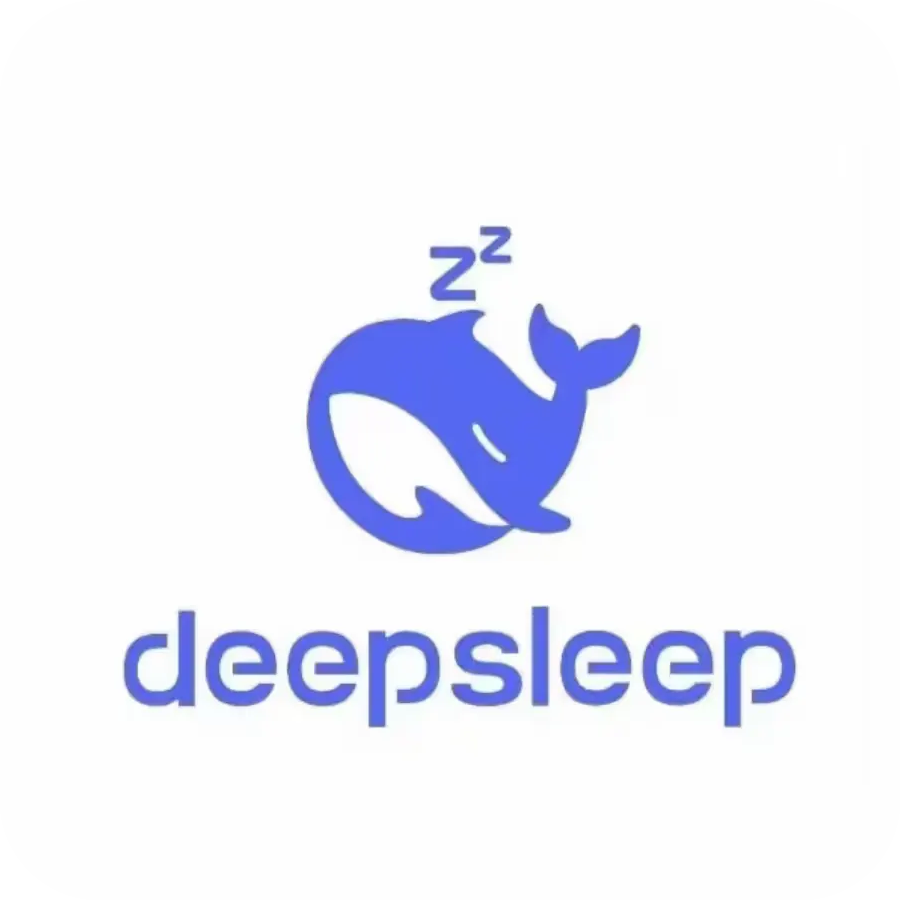

# 塞壬唱片 · Monster Siren Player

<p align="center">
  
</p>

<p align="center">
  <strong>Monster Siren Player</strong> —— 为塞壬唱片（Monster Siren Records）打造的第三方桌面音乐播放器。
</p>

<p align="center">
  
  
  
  
  
  
  
</p>

---

## ✨ 核心特性

- **首页**：品牌区与最新专辑单张精选，左侧封面、右侧简介与播放按钮。
- **曲库**：全部歌曲（虚拟滚动，几千首也不卡）、全部专辑、专辑详情与整张播放。
- **搜索**：按歌曲 / 专辑 / 艺人即时过滤，结果按专辑分组；专辑与歌曲区块可折叠，默认展开。
- **收藏**：一键收藏，固定在侧边栏「我的歌单」顶部，名称为「我的收藏」，歌曲支持拖拽排序。
- **歌单**：新建 / 重命名 / 删除、批量加入、单曲移除、整单播放，歌曲可拖拽排序。
- **播放队列**：点歌建队、下一首播放、添加到队列、随机 / 单曲循环 / 列表循环、队列即拖即排。
- **歌词**：LRC 解析、逐行滚动、点击跳转、沉浸式歌词页。
- **沉浸式播放**：全屏封面、模糊背景、迷你队列抽屉、快捷键（空格 / 左右切歌 / Esc 收起），深色与浅色主题分别适配。
- **设置**：内容区卡片页，顶部标签分为外观 / 数据 / 关于。
  - 外观：深色 / 浅色 / 跟随系统、主题色（预设 / 色码 / 取色器）、界面字体、记住窗口大小、关闭窗口行为、界面缩放（75%–150%，可一键重置）。
  - 数据：日志上限、三个配置文件、备份 / 恢复 / 导出 / 删除备份、按类别清除数据。
  - 关于：版本、技术栈、曲库统计与版权说明。
- **桌面细节**：自绘标题栏、窗口拖动与窗口控制（最小化 / 最大化 / 关闭）、系统托盘（显示主窗口、播放控制、退出）、关闭窗口时最小化到托盘或直接退出、系统媒体控制（SMTC / Media Session）、全局快捷键。
- **日志**：每次启动一个文件，持续记录导航、播放、收藏、歌单、设置变更与接口失败；按大小自动清理。

## 🛠️ 技术栈

- **Desktop Shell**：[Tauri 2.12](https://tauri.app/)（Rust）
- **Frontend**：[React 19](https://react.dev/) + [TypeScript 6](https://www.typescriptlang.org/)
- **Build Tool**：[Vite 8](https://vite.dev/)
- **State Management**：[Zustand 5](https://zustand.docs.pmnd.rs/)（persist 持久化）
- **Icons**：[lucide-react](https://lucide.dev/)
- **CSS**：原生 CSS + 设计变量，无 UI 框架
- **Font**：[MiSans](https://hyperos.mi.com/font) VF（内置可变字体），系统字体经 DirectWrite 枚举
- **Testing**：[Vitest 5](https://vitest.dev/) + happy-dom

## 🚀 快速开始

### 前置要求

- Windows 10/11（WebView2 已随系统或 Edge 安装）
- [Node.js](https://nodejs.org/) ≥ 20
- [Rust](https://www.rust-lang.org/) stable（MSVC 工具链）
- Visual Studio 2022 Build Tools（C++ 与 Windows SDK）

### 本地开发

1. **安装依赖**

   ```powershell
   cd app
   npm install
   ```

2. **启动开发**

   ```powershell
   .\dev.cmd
   ```

   `dev.cmd` 会用 `vswhere.exe` 找到 Visual Studio，加载 `vcvars64.bat` 后启动 Vite 与 Tauri。

   只跑前端界面：

   ```powershell
   npm run dev
   ```

   前端预览地址为 `http://localhost:1420`；加 `?mock=1` 可使用离线演示数据。

3. **检查与测试**

   ```powershell
   npm run typecheck
   npm test
   ```

4. **构建便携版**

   ```powershell
   .\build.cmd
   ```

   或手动执行：

   ```powershell
   npm run tauri build
   # 只出 exe，不下载 NSIS / WiX
   npm run tauri build -- --no-bundle
   ```

   `custom-protocol` 不能省略：它决定前端资源是否嵌入二进制；直接 `cargo build` 时需要加
   `--features custom-protocol`，否则窗口会去连 `http://localhost:1420` 而显示空白。

## 📁 数据与配置

应用不写系统 AppData，所有个人数据都在程序自己的目录里：

```text
<数据根>/
├── config/          # 设置、歌单、播放记录
│   └── cache/       # 曲库缓存（可删，会自动重建）
├── logs/            # 每次启动一个日志文件
└── backups/         # 数据页创建的配置备份
```

| 环境 | 数据根 |
| --- | --- |
| 开发（`.\dev.cmd` / `npm run tauri dev`） | `app`（项目根） |
| 发布版 / 便携 exe | exe 所在目录 |
| 自定义 | 环境变量 `MSR_CONFIG_DIR` 指向 config 目录，`logs` / `backups` 位于其同级 |

`config` 只保留三个配置文件：

| 文件 | 内容 |
| --- | --- |
| `settings.json` | 主题模式、主题色、字体、界面缩放、窗口记忆、日志上限 |
| `library.json` | 收藏 + 歌单（一个文件两部分） |
| `session.json` | 上次关闭前的队列、当前歌曲、播放模式、音量与静音 |

曲库缓存位于 `config/cache/library.json`，不属于配置，备份不包含。
旧版本分散存储的 `favorites.json` / `playlists.json` / `playback.json` / `library-cache.json`
会在启动时自动合并进新布局并清理。

### 备份与恢复

数据页点「立即备份」会把三个配置文件打包到 `backups/backup-YYYY-MM-DD_HH-MM-SS.json`；
列表里可以恢复、导出到任意位置或删除备份。恢复会覆盖当前配置并自动重新加载。

### 清除数据

数据页支持按类别清除：设置与偏好、歌单与收藏、播放记录、曲库缓存、日志、备份。
涉及设置 / 歌单 / 播放记录时会自动重新加载；清除操作不可撤销。

### 日志

日志文件名为启动时间 `YYYY-MM-DD_HH-MM-SS.log`，放在与 `config` 同级的 `logs/` 目录。
运行期间持续写入导航、播放、收藏、歌单、设置、接口失败等事件，失败行带 `WARN` / `ERROR`
前缀，每 10 分钟一条 `heartbeat`。设置页的「日志总大小上限」（64–10240 KB，默认 512 KB）
作用于整个目录：单文件超限会滚到新文件，目录超限从最旧的文件开始删除。

> WebView2 自身的浏览器缓存仍在 `%LOCALAPPDATA%\com.monster-siren.player\EBWebView`，
> 这是运行时的要求，不含收藏 / 歌单等用户数据，删掉会自动重建。

## 🎨 设置说明

- **主题模式**默认深色，可切换浅色或跟随系统；浅色模式同时适配主界面与沉浸式歌词页。
- **主题色**支持预设色板、`#rrggbb` 色码输入和取色器，作用于按钮、高亮、进度条与背景光。
- **字体**默认内置 [MiSans](https://hyperos.mi.com/font) VF，自动枚举本机字体并支持搜索；选择只更新预览，点「应用」才全局生效。
- **记住窗口大小**保存尺寸、位置与最大化状态，下次启动恢复。
- **关闭窗口时**可选择最小化到托盘继续播放，或直接退出程序。
- **界面缩放**范围 75%–150%，旁边的「重置」恢复 100%。

## 🧪 测试

```shell
npm run typecheck    # tsc --noEmit
npm test             # 队列 / 歌词 / 曲库 / 存储布局 / 主题 / 整页渲染
npm run build        # 类型检查 + 前端产物
```

当前共 7 个测试文件、93 项测试。

## 🏗️ 编译发布

```powershell
.\build.cmd
```

发布版是**便携式**的：数据写在 exe 同级的 `config` 目录，请把程序放在可写目录
（例如 `D:\Apps\MonsterSiren`），不要放到 `Program Files`；如果必须安装在系统目录，
可以用环境变量 `MSR_CONFIG_DIR` 把数据目录指到用户可写的位置。

## 🧰 故障排查

### `cl.exe` 报 `D8050` / `c1.dll` / `cannot execute`

编译器子进程被拦截或环境未就绪：

1. 安全软件里把 `app` 项目目录、`%USERPROFILE%\.cargo`、`%USERPROFILE%\.rustup`
   以及 `...\Microsoft Visual Studio\2022\Community\VC` 加入信任 / 排除；
2. 用 `dev.cmd` 启动（会先加载 `vcvars64.bat`）；
3. 仍然失败就 `cd src-tauri && cargo clean` 后重试；
4. 并行度过高时先 `set CARGO_BUILD_JOBS=4`。

### 启动即 panic：`Failed to setup app: 拒绝访问。 (os error 5)`

程序启动时会静默检查数据目录，只有写不了时才打印一行提示：

```text
[monster-siren] 无法写入数据目录：<路径>（拒绝访问 …）。请把程序放到可写目录…
```

用 `set MSR_DEBUG=1` 再启动可以打印 exe 路径、配置目录、日志目录与进程完整性级别。
常见原因是 exe 继承了目录的「低完整性」标签（`integrity` 为 `S-1-16-4096`），进程以低权限运行，
写不了 `config` / `%TEMP%`。用管理员终端修复：

```powershell
icacls "<项目目录>\app" /setintegritylevel "(OI)(CI)M" /T /C /Q
icacls "<项目目录>" /setintegritylevel "(OI)(CI)M" /T /C /Q
```

必须带 `(OI)(CI)`，这样后续新生成的文件（包括重建的 `target`）才会继承 Medium 标签。

### 窗口空白 / 一直转圈

确认构建时带了 `custom-protocol`；开发模式确认 Vite 已监听 `http://localhost:1420`。

### Vite 启动报 `spawn EPERM`

项目已用 `--configLoader native` 规避；如果仍出现，检查是否在受限沙箱 / 终端里运行，
换普通终端或把项目放到普通目录。

## 🙏 鸣谢

- [塞壬唱片 Monster Siren](https://monster-siren.hypergryph.com/) - 塞壬唱片官网
- [MonsterSirenApi](https://github.com/QingXia-Ela/MonsterSirenApi) - 塞壬唱片官网的 Node.js API 封装与接口文档，本项目的接口字段和调用方式参考了它。
- [Tauri](https://tauri.app/)、[React](https://react.dev/)、[Vite](https://vite.dev/)、
  [Zustand](https://zustand.docs.pmnd.rs/)、[lucide](https://lucide.dev/)
- [MiSans](https://hyperos.mi.com/font/) - 内置可变字体
- [DeepSeek Harness](https://www.deepseek.com/harness/) / [DSH NEXT](https://www.dshdesktop.cn/) - 大肥鱼真厉害😋

## 📄 免责声明

本项目是基于公开接口开发的第三方播放器，仅供个人学习和技术研究使用。

- **数据来源**：曲库、封面与歌词均通过塞壬唱片公开接口获取，本项目不存储、不传播音频文件。
- **版权声明**：音乐内容版权归 **鹰角网络**、**塞壬唱片-MSR** 及相应版权方所有，内置 **MiSans** 字体版权归小米科技所有。
- **使用限制**：禁止用于商业用途或违法行为；因使用本项目产生的纠纷与损失由使用者自行承担。
- **争议处理**：如版权方认为本项目侵犯其权益，请通过 Issues 联系，我们会积极配合处理。

---

<p align="center">
  
</p>
此项目是一个纯AI产物，第一次写项目，希望能帮助到各位博士。如果有bug，我尽力让大肥鱼吃掉🙏